# 🩺 Chronic Kidney Disease (CKD) Risk Prediction & Clinical Analytics

<div align="center">


[](https://www.python.org/)
[](https://scikit-learn.org/)
[](https://pandas.pydata.org/)
[](https://numpy.org/)
[](https://jupyter.org/)
[](https://github.com/)

An end-to-end clinical data science and machine learning pipeline for **Chronic Kidney Disease (CKD)** exploratory data analysis, diagnostic biomarker profiling, unsupervised patient cohort clustering, and multi-stage risk classification.

[Overview](#-project-overview) • [System Architecture](#-system-architecture) • [Data Model & ER Diagram](#-data-model--entity-relationship-diagram) • [Key Insights & Visualizations](#-key-insights--visualizations) • [Feature Engineering](#-feature-engineering--domain-ratios) • [ML & Statistical Modeling](#-machine-learning--statistical-modeling) • [Getting Started](#-getting-started)

---

</div>

## 📌 Project Overview

**Chronic Kidney Disease (CKD)** is a progressive loss in renal function over time, often asymptomatic in early stages until significant nephron damage has occurred. This project implements a comprehensive computational biology and clinical machine learning framework that evaluates a cohort of **20,538 patient records** across **43 clinical parameters** (including demographics, urinalysis, electrolyte balance, inflammatory markers, and renal function biomarkers).

### Key Objectives
* **Comprehensive Exploratory Data Analysis (EDA)**: Statistical profiling, univariate distributions, bivariate correlation analysis, and IQR outlier detection.
* **Domain-Driven Feature Engineering**: Clinically inspired biomarkers such as Blood Urea Nitrogen-to-Creatinine ratio (`BUN_Creatinine_Ratio`), Sodium-to-Potassium ratio, Cumulative Comorbidity index, Inflammation index, and log-transformed biochemical indicators.
* **Dimensionality Reduction & Multicollinearity Auditing**: Assessment of multicollinearity via Variance Inflation Factor (VIF) and variance decomposition via Principal Component Analysis (PCA).
* **Unsupervised Patient Stratification**: K-Means clustering ($k=3$) to uncover hidden phenotypic clusters based on physiological and nephrological profiles.
* **Supervised Risk Stratification Modeling**: Multi-class classification pipeline predicting risk stages (`No_Disease`, `Low_Risk`, `Moderate_Risk`, `High_Risk`, `Severe_Disease`).

---

## 🏗 System Architecture

The following diagram illustrates the end-to-end data engineering, statistical profiling, feature transformation, unsupervised discovery, and machine learning pipeline:

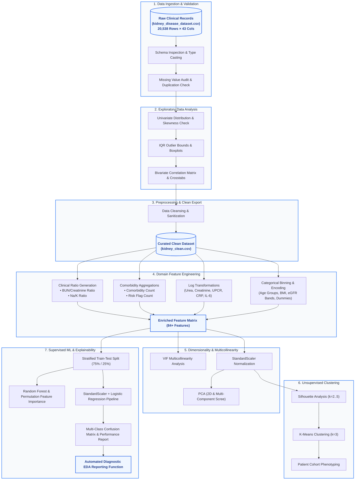

---

## 🧬 Data Model & Entity-Relationship Diagram

The dataset represents multidimensional clinical entities covering patient demographics, vital signs, urinalysis, renal biomarkers, hematology, medical comorbidities, and target risk outcomes:

```mermaid
erDiagram
    PATIENT_DEMOGRAPHICS ||--|| VITAL_SIGNS : has
    PATIENT_DEMOGRAPHICS ||--|| RENAL_PANEL : measured_in
    PATIENT_DEMOGRAPHICS ||--|| URINALYSIS_PANEL : tested_by
    PATIENT_DEMOGRAPHICS ||--|| HEMATOLOGY_PANEL : evaluated_by
    PATIENT_DEMOGRAPHICS ||--|| INFLAMMATORY_PANEL : monitored_in
    PATIENT_DEMOGRAPHICS ||--|| COMORBIDITIES_HISTORY : exhibits
    PATIENT_DEMOGRAPHICS ||--|| ENGINEERED_FEATURES : transformed_into
    PATIENT_DEMOGRAPHICS ||--|| CKD_TARGET_STRATIFICATION : classified_as

    PATIENT_DEMOGRAPHICS {
        int Patient_ID PK "Synthetic Identifier"
        float Age_of_the_patient "Years (5 - 90)"
        string Gender "Male / Female"
        float Body_Mass_Index_BMI "kg/m²"
        string BMI_Category "Underweight / Normal / Overweight / Obese"
        string Age_Group "Young / Adult / Middle_Age / Senior"
    }

    VITAL_SIGNS {
        float Blood_pressure "mm/Hg (80 - 180)"
    }

    RENAL_PANEL {
        float Blood_urea "mg/dl (7 - 200)"
        float Serum_creatinine "mg/dl (0.4 - 15)"
        float eGFR "Estimated GFR (mL/min/1.73m²)"
        string eGFR_Band "Very_Low / Low / Moderate / Near_Normal / Normal"
        float Cystatin_C_level "mg/L"
        float Serum_albumin_level "g/dL"
        float Sodium_level "mEq/L"
        float Potassium_level "mEq/L"
    }

    URINALYSIS_PANEL {
        float Specific_gravity_of_urine "Density (1.00 - 1.025)"
        float Albumin_in_urine "Scale (0 - 5)"
        float Sugar_in_urine "Scale (0 - 5)"
        string Red_blood_cells_in_urine "normal / abnormal"
        string Pus_cells_in_urine "normal / abnormal"
        string Pus_cell_clumps_in_urine "present / not present"
        string Bacteria_in_urine "present / not present"
        float Urine_protein_to_creatinine_ratio "UPCR"
        float Urine_output "mL/day"
    }

    HEMATOLOGY_PANEL {
        float Hemoglobin_level "gms"
        float Packed_cell_volume "PCV (%)"
        float White_blood_cell_count "cells/cumm"
        float Red_blood_cell_count "millions/cumm"
        float Platelet_count "cells/cumm"
    }

    INFLAMMATORY_PANEL {
        float C_reactive_protein_CRP "mg/L"
        float Interleukin_6_IL6 "pg/mL"
        float Parathyroid_hormone_PTH "pg/mL"
        float Cholesterol_level "mg/dL"
        float Random_blood_glucose_level "mg/dL"
    }

    COMORBIDITIES_HISTORY {
        string Hypertension "yes / no"
        string Diabetes_mellitus "yes / no"
        string Coronary_artery_disease "yes / no"
        string Pedal_edema "yes / no"
        string Anemia "yes / no"
        string Family_history_of_CKD "yes / no"
        string Smoking_status "never / former / current"
        float Duration_of_Hypertension "years"
        float Duration_of_Diabetes "years"
    }

    ENGINEERED_FEATURES {
        float BUN_Creatinine_Ratio "Derived (Urea / Creatinine)"
        float Sodium_Potassium_Ratio "Derived (Na / K)"
        int Comorbidity_Count "Sum of active comorbidities"
        int Kidney_Risk_Flag_Count "Sum of clinical risk flags"
        float Inflammation_Index "CRP × IL-6 composite"
        float Total_Comorbidity_Duration "Sum of chronic disease durations"
        int Cluster_Assignment "K-Means Cluster (0, 1, 2)"
    }

    CKD_TARGET_STRATIFICATION {
        string Target_Label "No_Disease / Low / Moderate / High / Severe"
        int Target_Code "Ordinal Encoded (0 - 4)"
    }
```

---

## 📊 Key Insights & Visualizations

### 1. Target Risk Class Distribution
The dataset is stratified across 5 diagnostic stages, reflecting a real-world clinical imbalance with a dominant healthy baseline and graduated severity categories:

| Target Class | Patient Count | Proportion (%) | Clinical Description |
| :--- | :---: | :---: | :--- |
| **`No_Disease`** | 16,432 | 80.0% | Normal renal parameters ($eGFR \ge 90$, normal creatinine/urea) |
| **`Low_Risk`** | 2,054 | 10.0% | Mild biochemical deviation or early risk markers |
| **`Moderate_Risk`** | 821 | 4.0% | Elevated creatinine/urea with mildly decreased eGFR |
| **`High_Risk`** | 821 | 4.0% | Marked renal impairment requiring clinical intervention |
| **`Severe_Disease`** | 410 | 2.0% | Critical stage / advanced nephropathy |

<div align="center">

| Risk Category Distribution | Class Frequency Count |
| :---: | :---: |
| 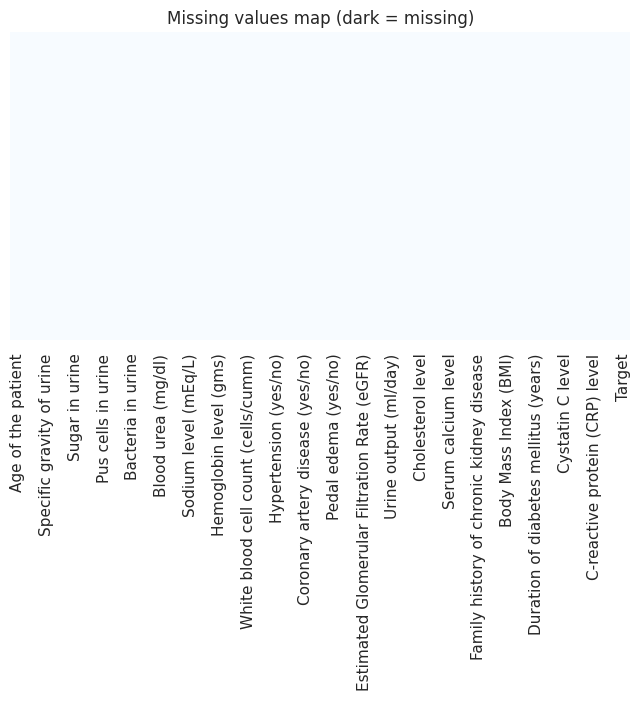 | 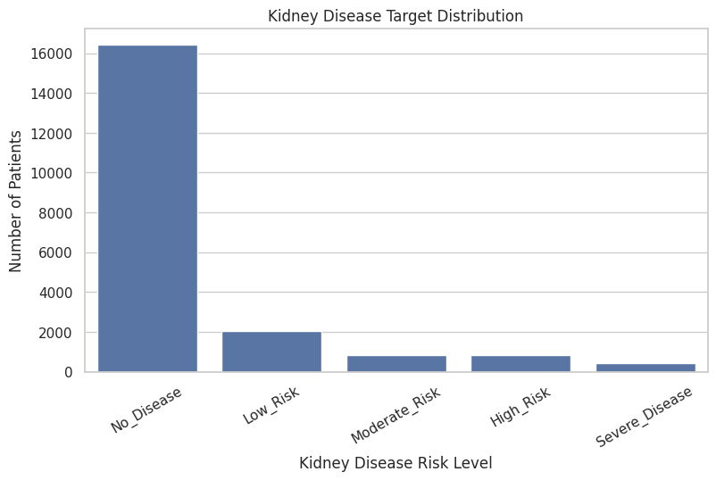 |

</div>

---

### 2. Clinical Biomarker Correlations & Interactions
The correlation matrix and bivariate scatter plots reveal key relationships:
* **Serum Creatinine vs. eGFR**: Inverse clinical relationship tracking glomerular filtration efficiency across disease severities.
* **Blood Urea vs. Serum Creatinine**: Critical indicator for pre-renal vs. intrinsic renal dysfunction.

<div align="center">

| Complete Biomarker Correlation Heatmap | Creatinine vs. eGFR Risk Trajectory |
| :---: | :---: |
| 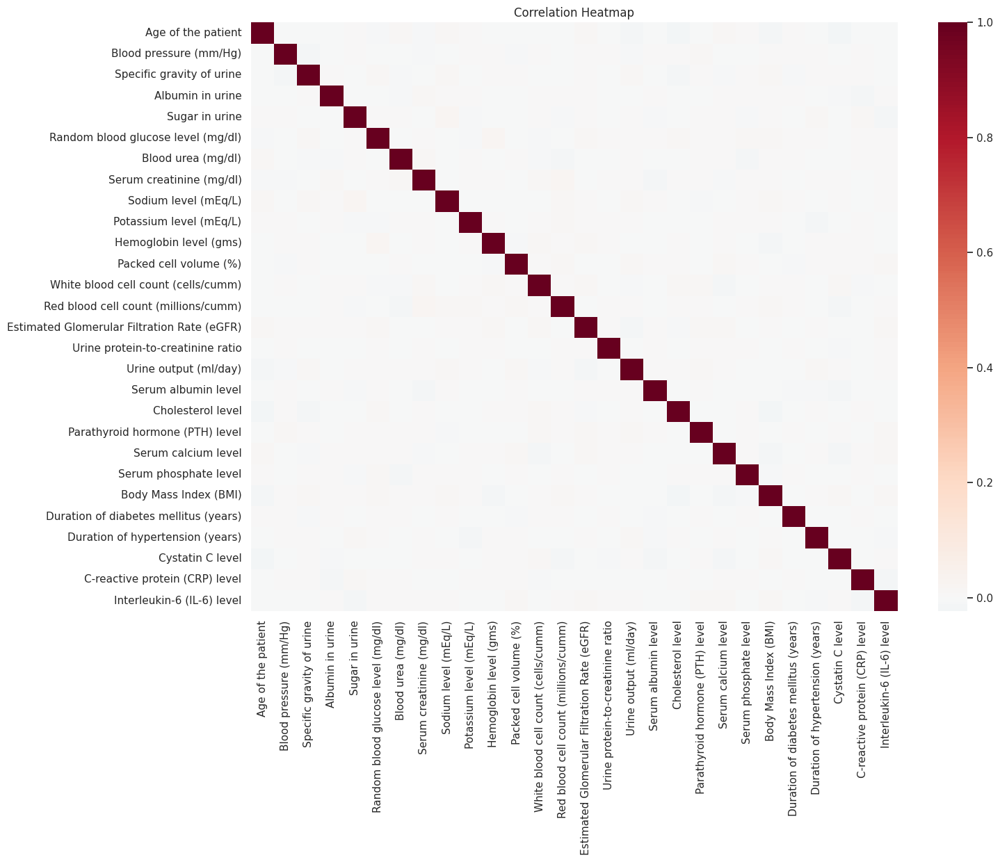 | 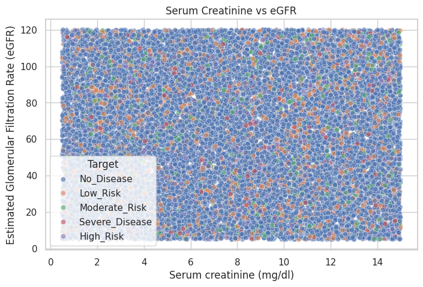 |

</div>

<div align="center">

| Blood Urea vs. Serum Creatinine | Pairplot of Key Biomarkers |
| :---: | :---: |
| 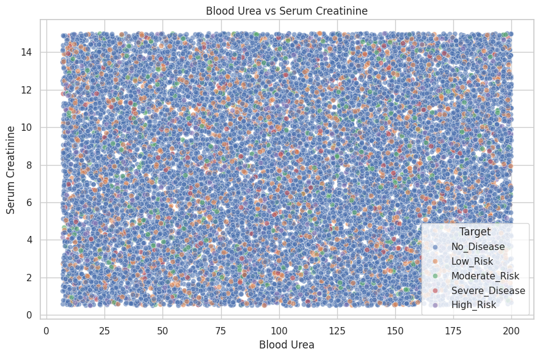 | 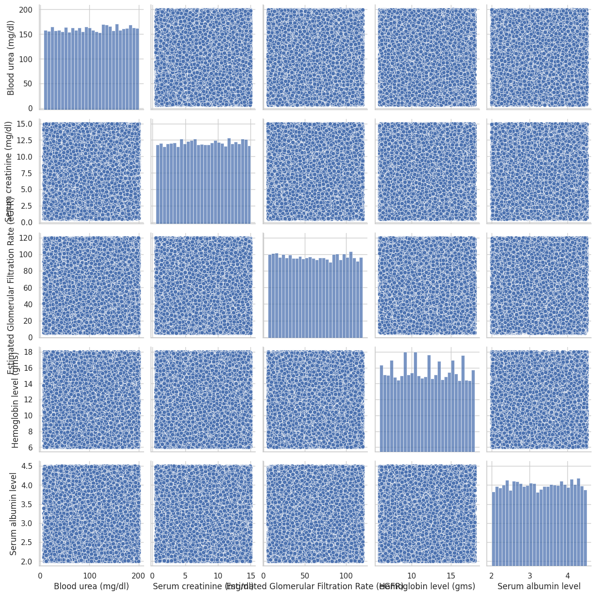 |

</div>

---

### 3. Patient Age Profiling & Subgroup Analysis
Age-stratified heatmaps demonstrate how renal function parameters shift across demographic brackets:

<div align="center">

| Age vs. eGFR Distribution | Creatinine by Age Group & Risk Stage |
| :---: | :---: |
| 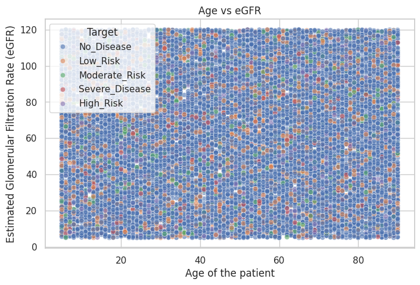 | 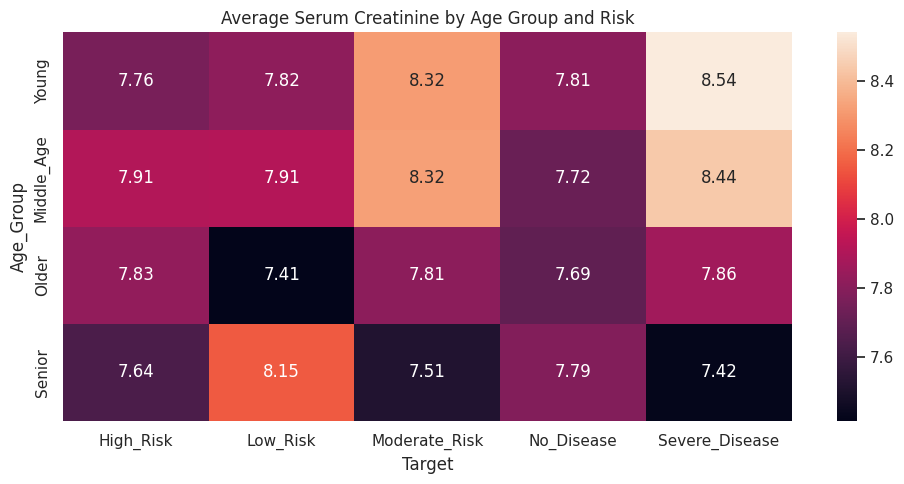 |

</div>

---

### 4. Feature Importance (Random Forest & Permutation)
Feature importance algorithms evaluate which biochemical and physical markers provide the highest predictive signal:

<div align="center">

| Random Forest Gini Importance | Permutation Feature Importance |
| :---: | :---: |
| 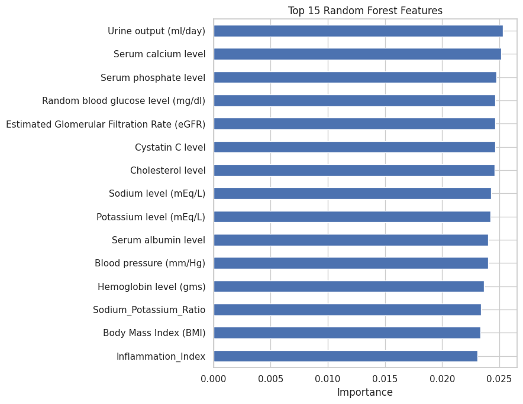 | 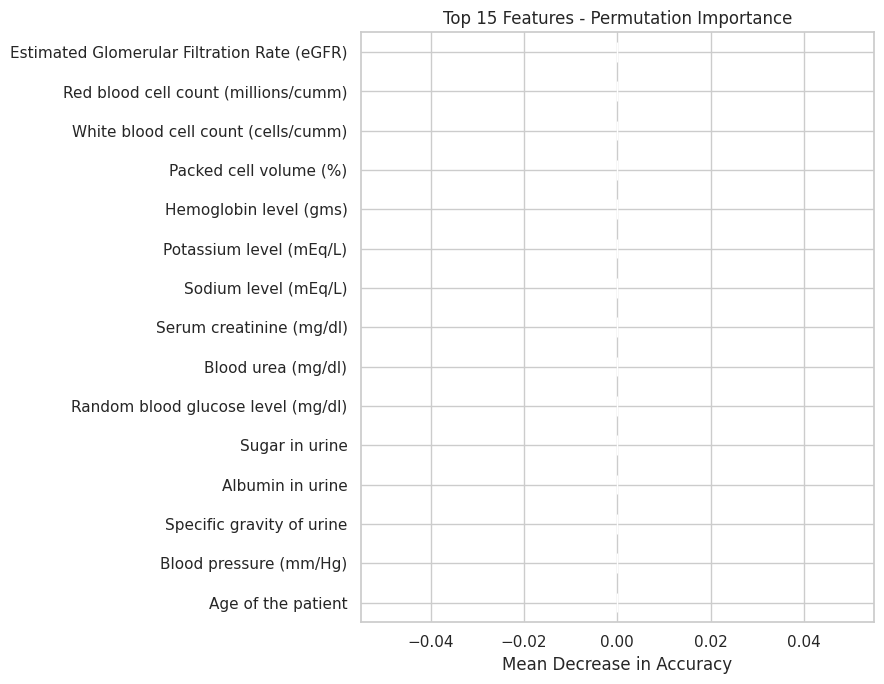 |

</div>

---

### 5. Dimensionality Reduction (PCA) & Unsupervised Clustering
Principal Component Analysis (PCA) decomposes the multidimensional biomarker space, while **K-Means Clustering ($k=3$)** identifies distinct patient phenotypes:

<div align="center">

| PCA Scree Plot & Cumulative Variance | PCA 2D Cohort Projection | K-Means Patient Clusters ($k=3$) |
| :---: | :---: | :---: |
| 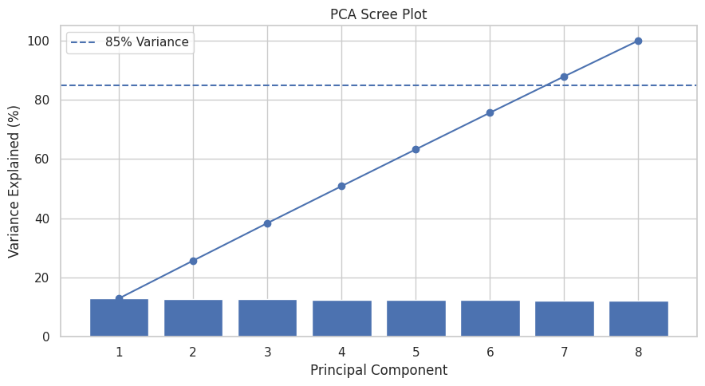 | 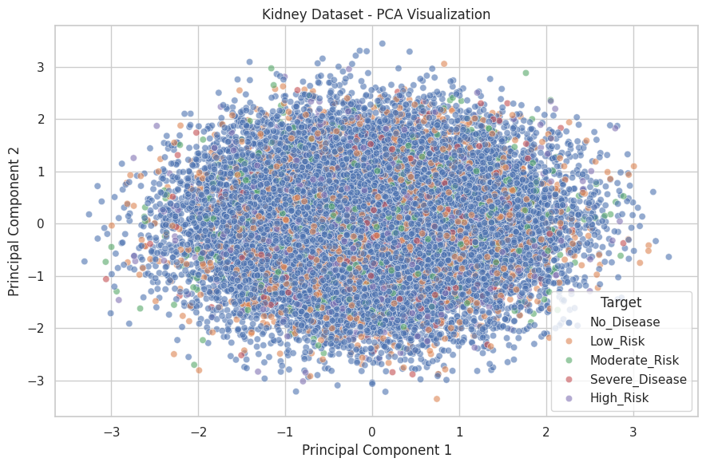 | 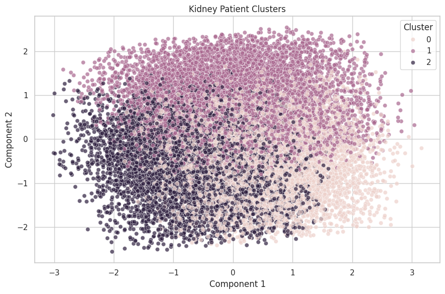 |

</div>

#### K-Means Cluster Phenotype Breakdown:
* **Cluster 0 (6,392 Patients)**: Moderate Urea ($104.36\text{ mg/dl}$), Creatinine ($7.94\text{ mg/dl}$), Low Hemoglobin ($9.75\text{ g/dL}$) — *Anemic Renal Impairment Subgroup*.
* **Cluster 1 (7,561 Patients)**: Higher eGFR ($64.16\text{ mL/min}$), Elevated Hemoglobin ($15.64\text{ g/dL}$) — *Preserved Function Cohort*.
* **Cluster 2 (6,585 Patients)**: Moderate eGFR ($62.09\text{ mL/min}$), Low Hemoglobin ($9.88\text{ g/dL}$) — *Intermediate Risk Cohort*.

---

### 6. Baseline Classification & Model Evaluation
A normalized **Logistic Regression** baseline classifier was evaluated with stratified 75/25 train-test split:

<div align="center">

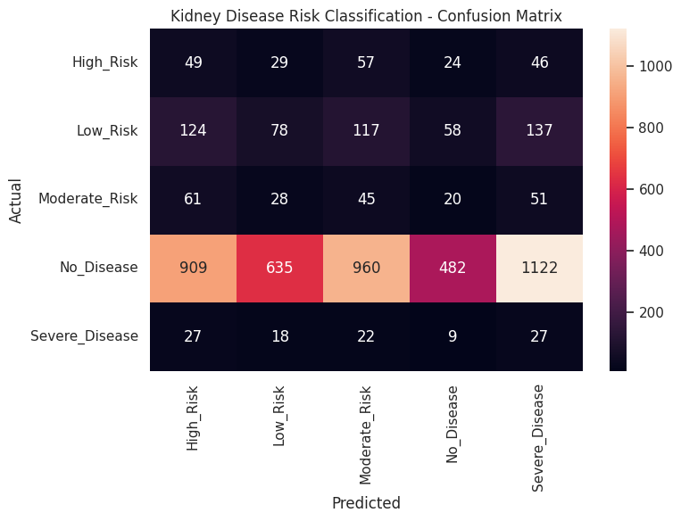

</div>

---

## 🔬 Feature Engineering & Domain Ratios

The project designs domain-specific physiological ratios to enhance predictive signal:

### 1. Mathematical Formulations
$$\text{BUN\_Creatinine\_Ratio} = \frac{\text{Blood Urea (mg/dl)}}{\text{Serum Creatinine (mg/dl)}}$$

$$\text{Sodium\_Potassium\_Ratio} = \frac{\text{Sodium Level (mEq/L)}}{\text{Potassium Level (mEq/L)}}$$

$$\text{Inflammation\_Index} = \ln(1 + \text{CRP}) \times \ln(1 + \text{IL-6})$$

$$\text{Comorbidity\_Count} = \sum [\text{Hypertension} + \text{Diabetes} + \text{CAD} + \text{Pedal\_Edema} + \text{Anemia}]$$

### 2. Skewness Mitigation via Log Transformation
Highly skewed clinical distributions were normalized using $\ln(1 + x)$:

| Biomarker Feature | Original Skewness | Log-Transformed Skewness | Skew Reduction |
| :--- | :---: | :---: | :---: |
| **Blood Urea (mg/dl)** | $-0.01$ | $-1.07$ | Stabilized tail |
| **Serum Creatinine (mg/dl)** | $-0.01$ | $-0.81$ | Normalized variance |
| **Urine Protein-to-Creatinine (UPCR)** | $+0.01$ | $-0.53$ | Mitigated extreme outliers |
| **White Blood Cell Count (WBC)** | $-0.01$ | $-0.55$ | Reduced right-tail leverage |
| **Parathyroid Hormone (PTH)** | $-0.02$ | $-0.66$ | Stabilized distribution |
| **C-Reactive Protein (CRP)** | $-0.01$ | $-0.79$ | Standardized inflammatory scale |

---

## 💻 Machine Learning & Statistical Modeling

### Pipeline Configuration
```python
from sklearn.pipeline import Pipeline
from sklearn.preprocessing import StandardScaler
from sklearn.linear_model import LogisticRegression
from sklearn.model_selection import train_test_split

# 1. Stratified Partitioning (75% Train, 25% Test)
X_train, X_test, y_train, y_test = train_test_split(
    X_ml, y_ml, test_size=0.25, random_state=42, stratify=y_ml
)

# 2. Scikit-Learn Scaler + Estimator Pipeline
model = Pipeline([
    ("scaler", StandardScaler()),
    ("logistic", LogisticRegression(max_iter=1000, multi_class="multinomial", random_state=42))
])

# 3. Fit & Predict
model.fit(X_train, y_train)
y_pred = model.predict(X_test)
```

---

## 📁 Repository Structure

```text
├── assets/
│   ├── banner.jpg                     # High-resolution project header banner
│   └── plots/                         # Extracted clinical analytical visualizations
│       ├── target_distribution.png    # Target risk distribution
│       ├── target_bar_chart.png       # Target frequency bar plot
│       ├── numerical_distributions.png# Histograms of all continuous features
│       ├── correlation_matrix.png     # Full Pearson correlation heatmap
│       ├── creatinine_vs_egfr.png     # Scatter: Creatinine vs. eGFR
│       ├── age_vs_egfr.png            # Scatter: Age vs. eGFR
│       ├── urea_vs_creatinine.png     # Scatter: Blood Urea vs. Creatinine
│       ├── pairplot_key_biomarkers.png# Multivariable pairwise relationships
│       ├── creatinine_by_age_heatmap.png # Mean creatinine grouped by age & risk
│       ├── rf_feature_importance.png  # Random Forest Gini feature importances
│       ├── permutation_importance.png # Permutation feature importances
│       ├── pca_scree_plot.png         # PCA explained variance scree plot
│       ├── pca_2d_projection.png      # 2D PCA patient space projection
│       ├── kmeans_clusters.png        # K-Means clustering scatter plot
│       └── confusion_matrix.png       # Multi-class baseline confusion matrix
├── Kidney_EDA.ipynb                   # Main interactive Jupyter Notebook with full analysis
├── requirements.txt                   # Project dependencies and package specifications
└── README.md                          # Comprehensive project documentation
```

---

## 🚀 Getting Started

### 1. Prerequisites
* Python 3.10 or higher
* `pip` package manager

### 2. Installation & Setup

1. **Clone or navigate to the repository directory**:
   ```bash
   cd "c:/1319 PROJECTS"
   ```

2. **Create a virtual environment (recommended)**:
   ```bash
   python -m venv .venv
   # Windows PowerShell:
   .venv\Scripts\Activate.ps1
   # Linux/macOS:
   source .venv/bin/activate
   ```

3. **Install required dependencies**:
   ```bash
   pip install -r requirements.txt
   ```

### 3. Launching the Interactive Notebook

```bash
jupyter notebook Kidney_EDA.ipynb
```

### 4. Running the Automated Diagnostic EDA Report

Inside the notebook or your Python script, invoke the custom `kidney_eda_report` utility for instant dataset diagnostics:

```python
from Kidney_EDA import kidney_eda_report # or run directly inside notebook

# Generate automated clinical dataset report
kidney_eda_report(df)
```

**Sample Output Summary:**
```text
============================================================
KIDNEY DISEASE EDA REPORT
============================================================
Dataset Shape: (20538, 45)
Missing Values: 0
Duplicate Rows: 0
Target Distribution:
  No_Disease: 16,432 (80.0%)
  Low_Risk: 2,054 (10.0%)
  Moderate_Risk: 821 (4.0%)
  High_Risk: 821 (4.0%)
  Severe_Disease: 410 (2.0%)
============================================================
```

---

## 📜 License & Citation

This project is open-source and available under the **MIT License**.

If you use this pipeline or analytical architecture in your research or clinical data science workflows, please cite:
```bibtex
@misc{ckd_risk_analytics_2026,
  author = {Clinical Data Science & AI Research Team},
  title = {Chronic Kidney Disease (CKD) Risk Analytics & Prediction Platform},
  year = {2026},
  publisher = {GitHub}
}
```

<div align="center">
<sub>Built with precision for computational nephrology and healthcare analytics.</sub>
</div>
